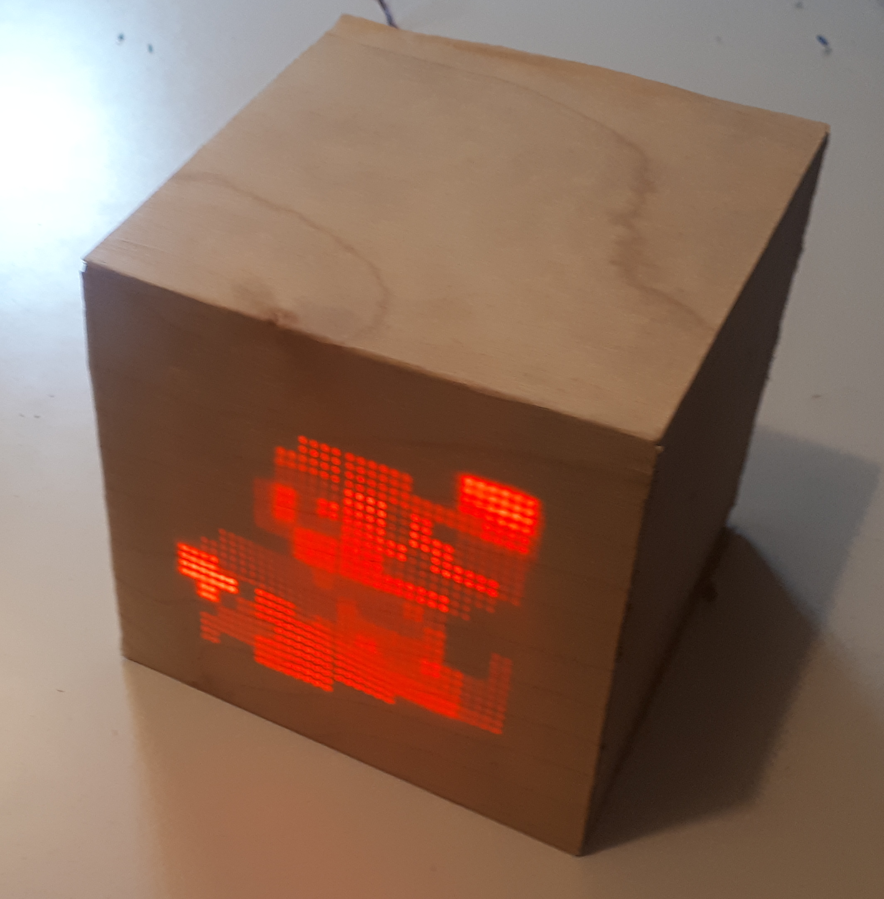

# PROJECT IN PROGRESS #




## How to build ##


### Pull the repo and all submodules ###

```
git clone --recurse-submodules https://github.com/ProrokWielki/Wooden-Clock.git
```

### Pull the docker image ###
```
docker pull pawelwarzecha/wooden_clock:0.5.2
```

### Run docker ###

```
docker run \
  --privileged \
  --network=host \
  -e DISPLAY=:0 \
  -e XAUTHORITY=/tmp/.Xauthority \
  -v $HOME/.Xauthority:/tmp/.Xauthority \
  -v /dev/bus/usb:/dev/bus/usb \
  -v /dev/:/dev/ \
  -v ./Wooden-Clock:/workspaces \
  -it pawelwarzecha/wooden_clock:0.5.2
```

### Build - inside docker ###

#### Supported build types ###
```
    ARM_Release  Release build - no debug symbols and 02
    ARM_Debug    Debug build - debug symbols and 00
    ARM_Size     Size optimized build - no debug symbols
    ARM_Speed    Speed optimized build - no debug symbols
    x86_Clang    Builds libs and unit tests for host machine using clang
    x86_GCC      Builds libs and unit tests for host machine using gcc
```
* **x86_*** builds are used for testing the project on the PC. CAn be used to run unit tests or use the GUI to emulate the hardware.
* **ARM_*** builds are for running the project on the dedicated board and running the `HIL` tests.

#### building ####

```
cd /workspaces/Software/STM
mkdir build
cd build
cmake -DCMAKE_BUILD_TYPE=<BUILD_TYPE> ..
make
```

## Running ##

### x86 build ###

#### Running unit tests ####

```
make test
```

#### Running the simulator ####

```
./src/pc/WoodenClockSimulator
```

### ARM build ###

For this you need to connect the board to the PC to be able to flash the software.

#### Running HIL tests ####

This will flash the target with the test bin and test if the behavior of the board is correct.

```
make test
```

#### Flashing the software ####

##### Flashing the internal flash ####

```
make flash
```

##### Flahsing the external flash ####

```
cd /workspaces/Software/Flasher
make
./flasher.py --file /workspaces/Software/STM/buil2/src/stm32/WoodenClock.elf --dev /dev/ttyUSB0
```


